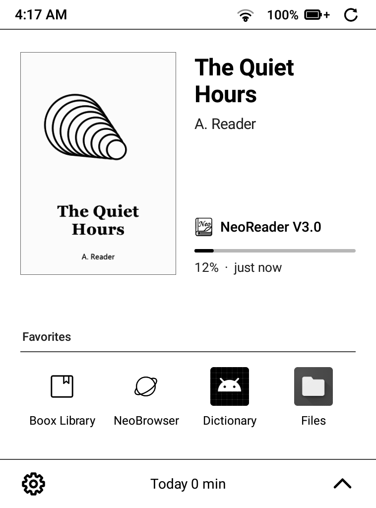

# Ink Home

A calm, reading-first home screen for e-ink Android tablets.

**[Website](https://inkhome.lh3k.dev)** · **[Download](https://github.com/Nyaughh/ink-home/releases/latest/download/ink-home.apk)** for Android 11 and newer



- **Your current book**: cover, title, progress and the app it opens in, read
  straight from NeoReader's library or tracked for any other reader.
- **Library**: covers pulled from EPUB, PDF and CBZ files; Reading, All,
  Finished and Collections; search, sort and type filters.
- **Reading time**: minutes per day and per book, streaks, a weekly chart and a
  monthly calendar. An optional daily goal.
- **Built-in reader**: EPUB and TXT laid out natively (no WebView), with page
  turns by tap, swipe or page keys, contents, font, size, spacing, margins and
  justification, a full refresh every few pages, and your place kept across
  text changes. Or open books in NeoReader, KOReader or another app; their
  time still counts, and KOReader's progress shows too.
- **Home**: the book you're reading, then all your other books, whatever app
  you read them in.
- The dock keeps Settings at the left, today's reading in the middle and the
  navigation menu under the chevron. Tap the status strip for device controls.
- Swipe sideways, press a page key or use the arrow buttons to move through
  paged lists. In Settings, text size and interface size can be adjusted separately.
- **Made for e-ink**: black and white, no animation, pages instead of
  scrolling (scrolling is a setting), hardware page buttons, and a true full
  refresh through the Onyx firmware to clear ghosting.
- **Status bar and quick panel**: clock, Wi-Fi, battery and notifications,
  with only the controls the hardware has.
- **Sleep screen and wallpaper**: your current book or any picture as the
  sleep screen; a faded wallpaper behind home.
- **Updates**: checks this repository's releases and installs new versions
  after asking.

Ink Home is plain Java on the Android framework, with no libraries. It has no
accounts, tracking or ads, and only goes online to check for its own updates.

## Install

On the tablet, download `ink-home.apk` from the
[latest release](https://github.com/Nyaughh/ink-home/releases/latest), open it,
then press Home and choose Ink Home > Always.

Or from a computer with `adb`:

```sh
adb install ink-home.apk
adb shell appops set dev.inkhome MANAGE_EXTERNAL_STORAGE allow   # find your books
adb shell appops set dev.inkhome GET_USAGE_STATS allow           # reading time
adb shell cmd notification allow_listener dev.inkhome/dev.inkhome.Notifs
adb shell cmd package set-home-activity dev.inkhome/.MainActivity
```

## Updates

About twice a day on Wi-Fi, Ink Home reads the latest release here. If it's
newer, it asks, downloads `ink-home.apk`, checks it against
`ink-home.apk.sha256`, and passes it to Android's installer. Android only
accepts an update signed with the same key as the installed app. The check can
be turned off in Settings > Updates.

## Building

You need JDK 17 and the Android SDK.

```sh
./gradlew assembleRelease
```

For development, run `./gradlew assembleDebug test`. The debug APK installs as
**Ink Home dev** (`dev.inkhome.dev`) alongside the release. It has its own
preferences, file-provider authority and permissions. Open its launcher icon
to try it while keeping your existing default Home app.

Release builds are signed with the key named in the file `INKHOME_SIGNING`
points to (or `../keys/keystore.properties`): `storeFile`, `storePassword`,
`keyAlias` and `keyPassword`. Without it they're signed with your debug key,
which can't update an official install.

To publish a release: bump `versionCode` and `versionName` in
`app/build.gradle`, build, then attach `ink-home.apk` and its `.sha256` to a
GitHub release tagged `v<versionName>`.
