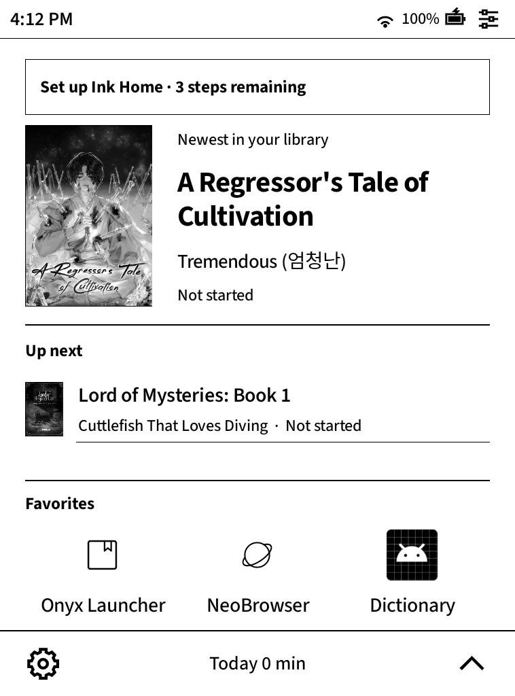

# Ink Home

A calm, reading-first home screen for e-ink Android tablets.

**[Website](https://inkhome.lh3k.dev)** · **[Download](https://github.com/Nyaughh/ink-home/releases/latest/download/ink-home.apk)** for Android 11 and newer



*Home on the Boox C69, captured during Phase 4 of the 2.0 redesign. The download above opens the latest published release.*

- **Your current book**: cover, title, progress and the app it opens in, read
  straight from NeoReader's library or tracked for any other reader.
- **Library**: covers pulled from EPUB, PDF and CBZ files; Reading, All,
  Finished and Collections; search, sort and type filters.
- **Reading time**: minutes per day and per book, streaks, a weekly chart and a
  monthly calendar. An optional daily goal.
- **Built-in reader**: EPUB and TXT laid out natively (no WebView), with page
  turns by tap, swipe or page keys, contents, font, size, spacing, margins and
  justification, a full refresh every few pages, and your place kept across
  text changes. Or open books in NeoReader, KOReader or another app; their
  time still counts, and KOReader's progress shows too.
- **Home** starts with a reading bento on new installations. Upgrades keep your
  existing book layout. Long-press an empty area or open
  **Settings › Appearance › Edit Home grid** to arrange tiles on a four-column,
  six-row page. Start a page with the Reading, Planner or Night arrangement, or
  build one from an empty grid. Tap a tile in the editor to move or resize it.
  **Page options › Tidy page** fits the tiles together to fill the page. Turn
  pages with arrows, a swipe or the page keys.
  Use tiles for your current book, Up next, favourite apps, clock and date,
  calendar, daily reading goal, reading month, battery or moon phase. Tap the
  moon tile to enter coordinates for local moonrise and moonset estimates.
- Add widgets from installed apps through the Home editor. Android asks you to
  approve binding when needed. The widget redraw limit controls how often live
  widgets can repaint the page. The default is once a minute.
- Switch back to a preset in **Settings › Appearance › Home layout**. Your
  grid is kept for the next time you open the editor. **Home layout file**
  exports and imports built-in tile placements as JSON. Add Android widgets
  again on the destination device.
- The dock keeps Settings at the left, today's reading in the middle and the
  navigation menu under the chevron. Tap the status strip for device controls.
- Swipe sideways, press a page key or use the arrow buttons to move through
  paged lists. In Settings, text size and interface size can be adjusted separately.
- **Made for e-ink**: paged lists and hardware page keys, monochrome or colour covers, and adjustable refresh on compatible Onyx firmware. LCD and OLED devices default to scrolling and can follow the system theme.
- **Status bar and quick panel**: clock, Wi-Fi, battery and notifications,
  with only the controls the hardware has.
- **Sleep screen and wallpaper**: generate a panel-sized picture from your current book or an image. Choose it in your device’s screensaver settings. Boox copies the image, so select it again after changing the artwork. Home can also show a faded wallpaper.
- **Updates**: checks this repository's releases and installs new versions
  after asking.

Ink Home is plain Java on the Android framework, with no libraries. It has no
accounts, tracking or ads, and only goes online to check for its own updates.

## Screen refresh and the Ink dot

On compatible Boox devices, **Clean screen** requests a flashing full refresh (GC 98). The dock menu, control panel, Home key while already on Home, and **Settings › Display & refresh › Strong clean now** use the same action. Automatic cleans at the configured page interval also request GC 98. When the native request is unavailable on e-ink, a manual clean flashes Ink Home’s window black and white.

The optional Ink dot provides the same full clean over other apps. Enable display-over-other-apps access for the standalone dot. Tap it to clean, drag it to any spot inside the screen, or hold it to open its menu. The dot remembers its position after a restart or reboot. Choose **Tuck to edge** in the menu to park it at the side. If the native request is unavailable, the dot briefly flashes a full-screen overlay.

The optional Ink Shell accessibility service adds a floating clock with panel shortcuts. It receives window-change events and uses the foreground app’s package name for per-app dot settings. Its Android service declaration disables access to window contents. The launcher works with Shell turned off.

## Install

On the tablet, download `ink-home.apk` from the
[latest release](https://github.com/Nyaughh/ink-home/releases/latest), open it,
then press Home and choose Ink Home > Always.

Or from a computer with `adb`:

```sh
adb install ink-home.apk
adb shell appops set dev.inkhome MANAGE_EXTERNAL_STORAGE allow   # find your books
adb shell appops set dev.inkhome GET_USAGE_STATS allow           # reading time
adb shell cmd notification allow_listener dev.inkhome/dev.inkhome.Notifs
adb shell cmd package set-home-activity dev.inkhome/.MainActivity
```

## Updates

About twice a day on Wi-Fi, Ink Home reads the latest release here. If it's
newer, it asks, downloads `ink-home.apk`, checks it against
`ink-home.apk.sha256` when that asset is present, and passes it to Android's installer. Android only
accepts an update signed with the same key as the installed app. The check can
be turned off in Settings > Updates.

## Development and release builds

You need JDK 17 and the Android SDK.

```sh
./gradlew assembleRelease
```

For development, run `./gradlew assembleDebug test`. The debug APK installs as
**Ink Home dev** (`dev.inkhome.dev`) alongside the release. It has its own
preferences, file-provider authority and permissions. Open its launcher icon
to try it while keeping your existing default Home app.

Release builds are signed with the key named in the file `INKHOME_SIGNING`
points to (or `../keys/keystore.properties`): `storeFile`, `storePassword`,
`keyAlias` and `keyPassword`. Without it they're signed with your debug key,
which can't update an official install.

For a release, bump `versionCode` and `versionName` in
`app/build.gradle`, build, then attach `ink-home.apk` and its `.sha256` to a
GitHub release tagged `v<versionName>`.
